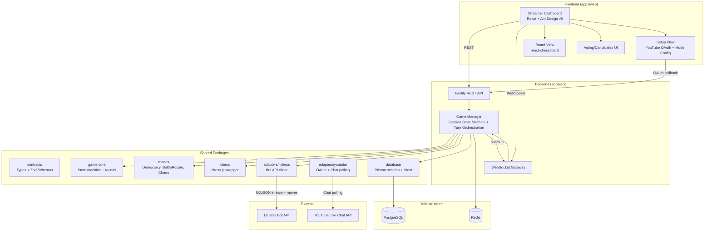
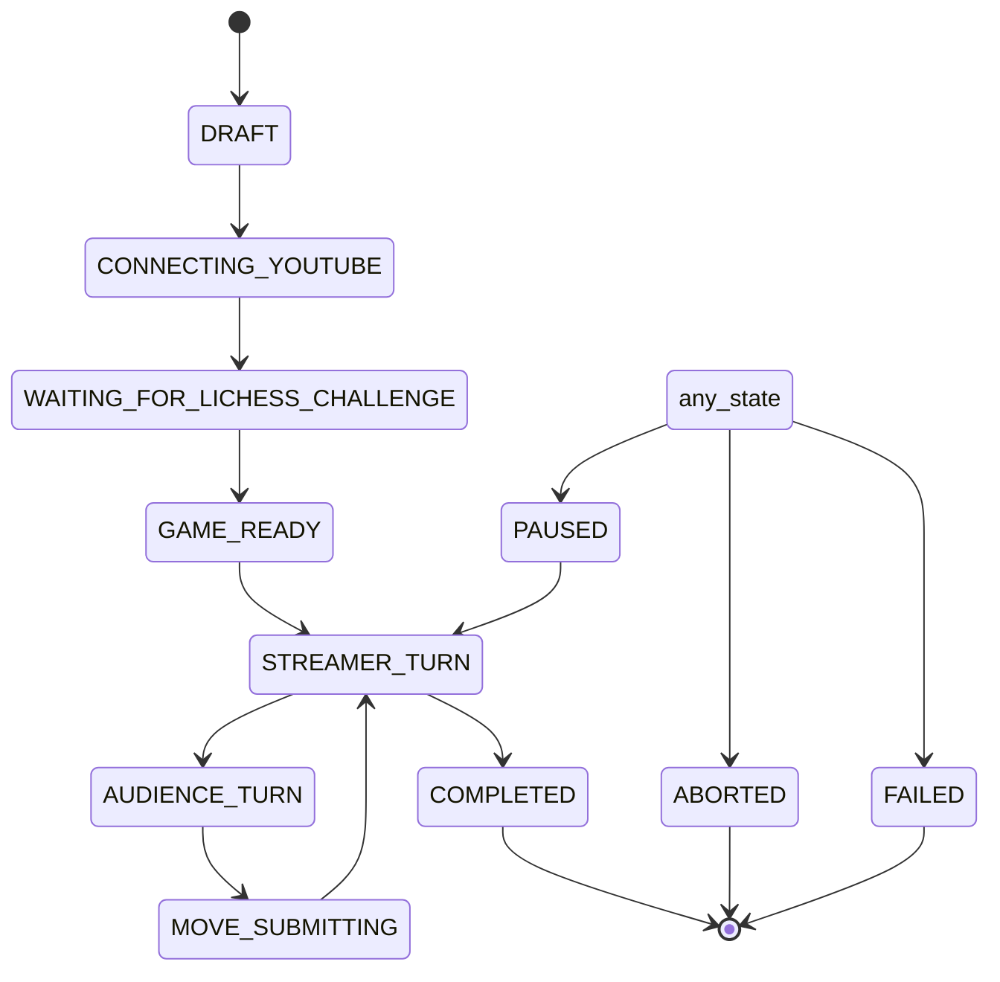

# CrowdChess Implementation Plan

## Process & Workflow Requirements

Two tracking documents are maintained throughout execution:

1. **PLAN.md** (this file) — The complete implementation plan. Serves as the reference for what needs to be done and the current roadmap.

2. **STEPS_KIRO.md** — An execution log. After each task is completed and verified, a new section is appended documenting:
   - The task number and name
   - Steps taken (what was built/changed)
   - CLI commands executed (exact commands, with context)
   - What was verified (test results, build output, demo confirmation)
   - Learnings (insights, gotchas, deviations from the plan, decisions made during implementation)

3. **Git commits** — After each task's milestone is completed AND verified (tests pass, build succeeds, demo confirmed), stage the relevant files and create a git commit with message format: `[Task N] Brief description`. This lets you review diffs at each stage and roll back if needed. Never commit before verification passes.

## Problem Statement

CrowdChess turns a livestream audience into an active chess opponent. A YouTube streamer plays chess (White) on Lichess against a CrowdChess bot account (Black), while viewers submit moves via YouTube Live Chat. The backend parses chat messages, validates moves against the current game state, applies one of three selection modes (Democracy, Battle Royale, Chaos), and submits the selected move through the Lichess Bot API. A companion React dashboard mirrors the live board state, shows voting/candidates, and provides session controls.

## Requirements

From the design document + confirmed technology choices:

- **Backend:** Node.js + TypeScript, Fastify framework, `@fastify/websocket` for real-time gateway
- **Frontend:** React + TypeScript + Vite, Ant Design v5 with custom theme via `ConfigProvider`
- **Monorepo:** Turborepo + pnpm workspaces, shared TypeScript packages
- **Database:** PostgreSQL with Prisma ORM (schema, migrations, type-safe client)
- **Cache/Coordination:** Redis (timers, deduplication, pub/sub)
- **Chess rules:** chess.js (SAN/UCI parsing, move validation, legal move generation)
- **Lichess:** Official Bot API (NDJSON game stream, UCI move submission, challenge lifecycle)
- **YouTube:** Data API v3 / Live Streaming API (OAuth 2.0, broadcast listing, live chat polling)
- **Board UI:** react-chessboard (synchronized board display, not game authority)
- **Testing:** Vitest (unit/integration), Playwright (E2E), fast-check (property-based)
- **Deployment:** Docker + docker-compose
- **Three game modes:** Democracy (vote), Battle Royale (competitive scoring), Chaos (random)
- **Session state machine:** DRAFT → CONNECTING_YOUTUBE → WAITING_FOR_LICHESS_CHALLENGE → GAME_READY → STREAMER_TURN → AUDIENCE_TURN → MOVE_SUBMITTING → STREAMER_TURN, with terminal states PAUSED/COMPLETED/ABORTED/FAILED
- **Key invariants:** Lichess is authoritative; one round produces at most one bot move; chat is untrusted input; external credentials never reach the browser

## Background (Research Findings)

- **YouTube Live Chat API:** `GET /youtube/v3/liveChat/messages` with `liveChatId` and `part=snippet,authorDetails`. Uses `pageToken`/`nextPageToken` for pagination and `pollingIntervalMillis` for poll rate guidance. Quota cost: 5 units/call. `snippet.authorChannelId` provides stable viewer identity. Error handling needed for `liveChatDisabled`, `liveChatEnded`, `liveChatNotFound`, `rateLimitExceeded`. The `list` polling approach will be primary (streamList endpoint not available in current Google API docs).
- **chess.js:** Pure TypeScript library, works in Node.js and browser. Supports FEN/PGN, SAN/UCI, legal move generation, check/checkmate/stalemate detection. Can be shared across backend and frontend packages.
- **Lichess Bot API:** `GET /api/stream/event` (incoming bot events as NDJSON), `GET /api/bot/game/stream/{gameId}` (game state as NDJSON), `POST /api/bot/game/{gameId}/move/{move}` (UCI move), `POST /api/challenge/{challengeId}/accept`. Bearer token auth. Game stream sends `gameFull`, `gameState`, `chatLine`, `opponentGone`.
- **Ant Design v5:** CSS-in-JS (no separate CSS imports needed). Custom theming via `ConfigProvider` with `theme.token`, `theme.components`, `theme.algorithm`.

## Proposed Solution

The system uses a monorepo with shared TypeScript packages, enabling type reuse across backend and frontend. The backend is a Fastify server with REST routes and a WebSocket gateway. It orchestrates the session lifecycle, ingests YouTube chat, validates moves with chess.js, applies mode strategies, and submits moves to Lichess via the Bot API. The frontend is a React + Ant Design dashboard that provides streamer setup, live board display, voting/candidate views, and session controls, receiving real-time updates via WebSocket.

### Architecture Diagram



### Session State Machine



## Repository Structure

```
crowdchess/
├── apps/
│   ├── web/                      # React + Vite + Ant Design v5
│   │   ├── src/{components,pages,hooks,theme}/
│   │   ├── package.json
│   │   ├── vite.config.ts
│   │   └── tsconfig.json
│   └── api/                      # Fastify backend
│       ├── src/{routes,ws,services,plugins}/
│       ├── package.json
│       └── tsconfig.json
├── packages/
│   ├── contracts/                # Shared types + Zod schemas
│   ├── chess/                    # chess.js wrapper
│   ├── game-core/                # Session state machine + turn orchestration
│   ├── modes/                    # Democracy, BattleRoyale, Chaos strategies
│   ├── adapters/
│   │   ├── lichess/              # Lichess Bot API adapter
│   │   └── youtube/              # YouTube OAuth + Live Chat
│   ├── database/                 # Prisma schema + client
│   └── config/                   # Shared config + env validation
├── infra/docker/
├── .kiro/{specs,steering}/
├── turbo.json
├── pnpm-workspace.yaml
├── PLAN.md
├── STEPS_KIRO.md
└── README.md
```

## Task Breakdown

Each task must:
1. Build on previous tasks (no orphaned code)
2. Include tests (TDD where practical)
3. Pass verification (build + tests + demo) before committing
4. Append to STEPS_KIRO.md after completion
5. Create a git commit: `[Task N] description`

---

### Phase 0: Foundation & Infrastructure

---

#### Task 1: Monorepo Scaffolding

Objective: Set up the Turborepo + pnpm workspaces monorepo with the full package structure, base TypeScript/ESLint/Prettier configuration, a working dev pipeline, and create the PLAN.md and STEPS_KIRO.md tracking documents.

Implementation guidance:
- Initialize `package.json` at root with pnpm, `pnpm-workspace.yaml` defining `apps/*`, `packages/*`, and `packages/adapters/*` globs
- Create `turbo.json` with `build`, `dev`, `test`, `lint`, `db:generate`, `db:migrate` tasks
- Create base `tsconfig.json` with strict mode and Bundler moduleResolution
- Set up Prettier at root with project formatting rules
- Create stub `package.json` for all packages and apps (empty exports for now)
- Create the directory structure shown in the repository layout
- Add `.gitignore` for `node_modules`, `dist`, `.env`, Prisma generated client
- Create PLAN.md and STEPS_KIRO.md at the project root
- Create `.env.example` with all required environment variables documented

Test requirements:
- `pnpm install` completes without errors
- `pnpm build` builds all packages (even if empty)
- `pnpm dev` starts placeholder dev servers for both apps
- Package imports resolve via TypeScript path aliases and pnpm workspace symlinks
- PLAN.md and STEPS_KIRO.md exist at project root

Demo: Run `pnpm dev` and see both the API and web dev servers start. Import a type from `packages/contracts` into both `apps/api` and `apps/web` and confirm it compiles.

Commit: `[Task 1] Monorepo scaffolding with Turborepo, pnpm workspaces, and tracking documents`

---

#### Task 2: Shared Contracts Package

Objective: Define all shared TypeScript types and Zod validation schemas for REST API requests/responses, WebSocket events, and domain models.

Implementation guidance:
- In `packages/contracts/src/models/`, define types for `Session`, `Game`, `Round`, `MoveCandidate`, `Vote`, `Score`, `ChatEvent`, `GameEvent`
- In `packages/contracts/src/api/`, define request/response types and Zod schemas for all REST endpoints
- In `packages/contracts/src/events/`, define discriminated union types for WebSocket events: `session.updated`, `round.opened`, `round.updated`, `round.closed`, `game.state`, `move.confirmed`, `leaderboard.updated`
- Define `SessionStatus`, `RoundStatus`, `GameMode` enums matching the state machine
- Export everything from `packages/contracts/src/index.ts`
- Add Zod schemas alongside types for runtime validation

Test requirements:
- Unit tests verifying Zod schemas accept valid input and reject invalid input
- Type-level tests ensuring discriminated unions are exhaustive
- Package builds and exports are correctly typed

Demo: Import `SessionStatus` and a WebSocket event type in both `apps/api` and `apps/web`. Confirm TypeScript compiles and Zod schemas validate sample payloads.

Commit: `[Task 2] Shared contracts package with Zod schemas and WebSocket event types`

---

#### Task 3: Database Package (Prisma)

Objective: Create the Prisma schema matching the data model in the design document, set up migrations, and export a generated Prisma client.

Implementation guidance:
- In `packages/database/prisma/schema.prisma`, define models: `User`, `YoutubeConnection`, `LichessBotConnection`, `Session`, `Game`, `Round`, `ChatEvent`, `MoveCandidate`, `Vote`, `Score`, `GameEvent`
- Add unique constraints: `(round_id, viewer_id)` for votes, `(round_id, viewer_id, canonical_uci)` for candidate dedup, platform message ID for chat dedup
- Configure Prisma to generate the client into `packages/database/src/generated/`
- Export the Prisma client instance and types from `packages/database/src/client.ts`
- Create an initial migration
- Add `db:generate` and `db:migrate` scripts wired into `turbo.json`

Test requirements:
- Migration applies cleanly to a fresh PostgreSQL instance
- Prisma client can perform CRUD on each model
- Unique constraints reject duplicates
- Integration test using a test database (via docker-compose from Task 5)

Demo: Run `pnpm db:migrate` against a fresh database, then run a script that creates a session, adds rounds, and queries them back.

Commit: `[Task 3] Prisma database package with schema, migrations, and client`

---

#### Task 4: Chess Rules Package

Objective: Wrap chess.js with a clean API for SAN/UCI move parsing, normalization, legal move validation, and game state queries.

Implementation guidance:
- `parseMove(input: string, fen: string): ParsedMove` accepting both SAN and UCI notation
- Normalize all moves to canonical UCI format
- Handle promotion moves (e.g., `e7e8q` in UCI, `e8=Q` in SAN)
- `validateMove(move: string, fen: string): ValidationResult`
- `getLegalMoves(fen: string): string[]` returning all legal moves in UCI
- Game state checks: `isCheckmate`, `isStalemate`, `isGameOver`, `whoseTurn`
- Re-export chess.js `Chess` class for direct use

Test requirements:
- Unit tests for SAN parsing (legal, illegal, ambiguous, promotion, castling, check)
- Unit tests for UCI parsing and normalization
- Property-based tests (fast-check) for round-trip SAN→UCI→SAN
- Tests for edge cases: wrong side to move, move from empty square

Demo: Run a script that loads a FEN, parses `Nf6` and `g8f6` as the same move, validates it as legal, lists all legal moves, and confirms a checkmate position.

Commit: `[Task 4] Chess rules package with SAN/UCI parsing, validation, and legal move generation`

---

#### Task 5: Docker Infrastructure

Objective: Create a `docker-compose.yml` for local development with PostgreSQL and Redis, with health checks and proper networking.

Implementation guidance:
- `infra/docker/docker-compose.yml` with `postgres` (PostgreSQL 16) and `redis` (Redis 7)
- Health checks, volumes, exposed ports
- `.env.example` with all required environment variables
- Wire `DATABASE_URL` and `REDIS_URL` into config package using Zod for validation
- Root-level `docker-compose.yml` for convenience

Test requirements:
- `docker compose up -d` starts both services and they pass health checks
- Backend can connect to PostgreSQL and execute a query
- Backend can connect to Redis and set/get a key
- Env validation rejects missing required variables

Demo: Run `docker compose up -d`, then run a script that connects to PostgreSQL, creates a test record, reads it back, and also does a Redis PING/SET/GET round-trip.

Commit: `[Task 5] Docker infrastructure with PostgreSQL, Redis, and environment config`

---

### Phase 1: Core Game Backend

---

#### Task 6: Session State Machine

Objective: Implement the session state machine with validated state transitions, persistence to PostgreSQL, and event emission.

Implementation guidance:
- Implement all states: `DRAFT`, `CONNECTING_YOUTUBE`, `WAITING_FOR_LICHESS_CHALLENGE`, `GAME_READY`, `STREAMER_TURN`, `AUDIENCE_TURN`, `MOVE_SUBMITTING`, `PAUSED`, `COMPLETED`, `ABORTED`, `FAILED`
- Transition table with conditions per transition
- `transition(currentState, event): nextState` with validation
- Persist state transitions with timestamps and reasons via Prisma
- Emit events on each state change (EventEmitter or callback)
- `canTransition(state, event)` for guards

Test requirements:
- Unit tests for all valid transitions
- Unit tests for rejected invalid transitions
- Unit tests for terminal states
- Integration test verifying state transitions persist to PostgreSQL

Demo: Create a session in DRAFT, transition through to STREAMER_TURN, verify each transition is valid and persisted, and confirm an invalid transition throws.

Commit: `[Task 6] Session state machine with validated transitions and persistence`

---

#### Task 7: Game Manager (Turn Orchestration)

Objective: Implement the game manager that orchestrates the turn lifecycle, manages audience rounds, enforces idempotency, and coordinates with the chess package.

Implementation guidance:
- `GameManager` class tracking current game state (FEN, whose turn, round info)
- Opens audience round when bot's turn (Redis timer, PostgreSQL metadata)
- Closes round and triggers mode strategy selection
- Re-validates selected move against current FEN before submission
- Idempotency: only one active round per game, version/state guard
- Handles streamer-moves-during-round (close round, discard stale candidates)
- `openRound`, `closeRound`, `selectMove` functions
- Define `GameModeStrategy` interface placeholder in `packages/modes/src/strategy.ts`

Test requirements:
- Unit tests for round open/close lifecycle
- Unit tests for idempotency guards
- Unit tests for stale candidate invalidation
- Integration test with mock Prisma and Redis

Demo: Create a game, open a round, close it, verify status transitions and idempotency guard. Simulate streamer move during open round, verify stale candidates discarded.

Commit: `[Task 7] Game manager with turn orchestration, round lifecycle, and idempotency guards`

---

#### Task 8: Lichess Adapter

Objective: Implement the Lichess Bot API adapter for bot authentication, challenge acceptance, NDJSON game stream parsing, and UCI move submission with reconnection.

Implementation guidance:
- HTTP client with Bearer token auth
- `acceptChallenge`, `declineChallenge`, `submitMove`, `resign`, `abort`
- `streamEvents()`: `GET /api/stream/event` (NDJSON)
- `streamGame(gameId)`: `GET /api/bot/game/stream/{gameId}` (NDJSON)
- Parse NDJSON line-by-line, yield typed events as async iterator
- Handle reconnection with backoff
- Implement `GameAdapter` interface as wrapper
- Handle HTTP errors, rate limiting (429), network interruptions

Test requirements:
- Unit tests with mocked HTTP responses
- Unit tests for NDJSON stream parsing
- Unit tests for reconnection logic
- Unit tests for error handling (403, 429, 404)

Demo: Using mock Lichess server/fixtures, connect to event stream, receive challenge, accept it, receive game state events, submit a move in UCI format.

Commit: `[Task 8] Lichess Bot API adapter with NDJSON streaming, challenge handling, and move submission`

---

#### Task 9: Backend API (Fastify + WebSocket)

Objective: Set up the Fastify server with REST routes, WebSocket gateway, Redis integration, and authentication middleware.

Implementation guidance:
- Fastify with `@fastify/websocket`, `@fastify/cors`, `@fastify/cookie`
- REST routes: YouTube connect/callback/broadcasts, sessions CRUD, start/pause/stop
- WebSocket gateway: session updates, round events, game state, move confirmed, leaderboard
- Redis pub/sub for multi-worker broadcasting
- Auth middleware for session control endpoints
- pino structured logging
- Prisma and Redis as Fastify decorators

Test requirements:
- Integration tests for each REST route (Fastify `inject`)
- Integration tests for WebSocket connection and event delivery
- Unit tests for auth middleware
- Verify Zod schema validation on request bodies

Demo: Start the API server, create a session, retrieve it, connect a WebSocket client, receive a `session.updated` event.

Commit: `[Task 9] Fastify backend API with REST routes, WebSocket gateway, and Redis pub/sub`

---

#### Task 10: Core Game Loop Integration

Objective: Wire together session state machine, game manager, Lichess adapter, and API server for a working streamer-vs-bot game loop with hardcoded bot moves.

Implementation guidance:
- Session orchestrator service: creates session, listens for challenges, accepts, opens game stream
- Bot's turn: opens round, immediately closes with hardcoded move, submits to Lichess
- Streamer's turn: transitions to STREAMER_TURN, waits for game stream
- Pushes all state changes through WebSocket gateway
- Handle game completion from Lichess stream
- Implement outbox/durable move-command pattern
- Reconcile local state with Lichess stream (Lichess is authoritative)

Test requirements:
- Integration test with mock Lichess: streamer moves, bot responds, game continues
- Test for game completion handling
- Test for backend restart recovery

Demo: A streamer challenges the CrowdChess bot on Lichess, plays a move, bot responds with hardcoded legal move. Dashboard WebSocket receives game.state and move.confirmed events.

Commit: `[Task 10] Core game loop integration with Lichess stream, hardcoded bot moves, and WebSocket updates`

---

### Phase 2: YouTube Chat Ingestion

---

#### Task 11: YouTube Adapter

Objective: Implement the YouTube OAuth 2.0 flow, broadcast listing, and live chat polling with deduplication and error handling.

Implementation guidance:
- OAuth 2.0 flow: authorization URL, token exchange, refresh token storage, auto-refresh
- `listBroadcasts(accessToken)`: `GET /youtube/v3/liveBroadcasts`
- `pollChat(liveChatId, pageToken?)`: `GET /youtube/v3/liveChat/messages` with pollingIntervalMillis
- Filter for `textMessageEvent`, extract message ID, author channel ID, text, publishedAt
- Handle errors: `liveChatDisabled`, `liveChatEnded`, `liveChatNotFound`, `rateLimitExceeded`
- Reconnect/retry with bounded backoff

Test requirements:
- Unit tests with mocked YouTube API responses for OAuth, broadcasts, chat polling
- Unit tests for error handling and deduplication

Demo: Using mock YouTube API responses, complete OAuth flow, list broadcasts, poll chat messages, verify deduplication.

Commit: `[Task 11] YouTube adapter with OAuth flow, broadcast listing, and live chat polling`

---

#### Task 12: Command Parser

Objective: Implement the command parser that extracts move commands from YouTube chat messages, validates syntax, normalizes to canonical UCI, and rejects malformed input.

Implementation guidance:
- `parseChatMessage(text, context)`: detect SAN and UCI moves, optional prefix format
- Reject non-move messages (URLs, arbitrary text, empty)
- Use `packages/chess` parser to normalize to canonical UCI
- Handle duplicate message IDs (YouTube message ID as idempotency key)
- Result types: `ParsedSubmission` (success) or `Rejection` (with reason)
- Per-viewer rate limiting

Test requirements:
- Unit tests for SAN/UCI parsing, rejections, rate limiting
- Property-based test: random non-chess strings are rejected

Demo: Feed a batch of sample chat messages (valid moves, garbage, duplicates), show parsed results.

Commit: `[Task 12] Command parser with SAN/UCI detection, normalization, and rate limiting`

---

#### Task 13: Move Candidate Pipeline

Objective: Implement the pipeline that validates parsed submissions against current FEN, deduplicates, stores legal candidates in the database.

Implementation guidance:
- `processSubmission(submission, roundContext)`: validate against FEN, reject illegal/stale
- Deduplicate: unique constraint on `(round_id, viewer_id, canonical_uci)`
- Store in `MoveCandidate` and `ChatEvent` tables via Prisma
- `getLegalCandidates(roundId)`: query all valid candidates
- Per-viewer submission tracking for Battle Royale
- Bounded candidate count to prevent spam
- Redis for fast deduplication cache

Test requirements:
- Unit tests for move validation, deduplication, candidate count bounding
- Integration test with PostgreSQL

Demo: Create a round, process submissions (legal, illegal, duplicates), show resulting candidate list.

Commit: `[Task 13] Move candidate pipeline with FEN validation, deduplication, and storage`

---

#### Task 14: YouTube Ingestion Integration

Objective: Wire YouTube adapter, command parser, and candidate pipeline into the game manager so chat messages flow through the full pipeline during an active audience round.

Implementation guidance:
- `chat-ingestion.ts` service: starts polling when session is active, processes each message through parser → pipeline
- Only accept submissions when a round is open
- Publish candidate updates via WebSocket (`round.updated`)
- Stop polling on session pause/stop or broadcast end
- Wire into game manager: round opens → ensure ingestion active; round closes → mode strategy selection (placeholder: first candidate)
- Handle YouTube disconnects with reconnect attempts

Test requirements:
- Integration test with mock YouTube chat: full round lifecycle
- Test for rejecting submissions outside active round
- Test for ingestion lifecycle and disconnect recovery

Demo: Start a session with mock YouTube chat, open audience round, feed chat messages, show candidates appearing in real-time. Close round, show selected move.

Commit: `[Task 14] YouTube ingestion integration with command parser, candidate pipeline, and game manager`

---

### Phase 3: Democracy Mode & Frontend

---

#### Task 15: Democracy Mode Strategy

Objective: Implement the Democracy mode strategy with candidate voting, vote tallying, tie-breaking, and no-vote behavior.

Implementation guidance:
- `openRound`: 20-second duration, voting enabled, one vote per viewer
- `handleVote`: one vote per viewer per round, allows vote changes (overwrite)
- `closeRound`: tallies votes, selects highest-voted legal candidate
- Tie-break: random among tied top candidates (configurable)
- No-vote: extend once by grace period (default 5s), then skip/abort
- Re-validate selected move against current FEN

Test requirements:
- Unit tests for vote tallying, vote changes, tie-breaking, no-candidate behavior
- Integration test with PostgreSQL

Demo: Create a round, add candidates, submit votes (including changes), close round, verify winner. Test tie and no-candidate scenarios.

Commit: `[Task 15] Democracy mode strategy with voting, tie-breaking, and no-vote handling`

---

#### Task 16: Frontend Dashboard Skeleton

Objective: Set up React + Vite + Ant Design v5 frontend with custom theme, routing, layout, and WebSocket client hook.

Implementation guidance:
- Install antd v5, react-router-dom, @tanstack/react-query, react-chessboard
- Custom theme via ConfigProvider: `theme.token` for design tokens, `theme.components` for overrides
- Routing: `/setup`, `/dashboard/:sessionId`
- Layout using antd Layout/Sider/Header/Content
- `useWebSocket` hook: auto-reconnect with backoff, typed events
- `useSession` hook: REST API calls

Test requirements:
- Unit tests for WebSocket hook
- Component test for layout
- Verify custom theme applied
- TypeScript compiles with strict mode

Demo: Run frontend dev server, navigate routes, see custom-themed antd layout, WebSocket hook connects.

Commit: `[Task 16] Frontend dashboard skeleton with Ant Design v5 custom theme, routing, and WebSocket hook`

---

#### Task 17: Streamer Setup Flow

Objective: Build the streamer setup flow pages: YouTube OAuth connect, broadcast selection, and game mode configuration using Ant Design components.

Implementation guidance:
- `YouTubeConnect.tsx`: Connect button, channel name display, Steps progress
- `BroadcastSelect.tsx`: Fetch broadcasts via react-query, antd Table/List
- `ModeConfig.tsx`: antd Form, Radio.Group (mode), InputNumber (duration), Switch (options)
- `SessionCreate.tsx`: Creates session, navigates to dashboard
- antd Steps to guide: Connect → Select → Configure → Start
- Loading/error states with Spin/Alert/message

Test requirements:
- Component tests for each step
- Test for OAuth flow trigger, broadcast list, mode config form

Demo: Navigate setup flow: connect YouTube (mocked), select broadcast, configure Democracy, create session. Verify form validations.

Commit: `[Task 17] Streamer setup flow with YouTube connect, broadcast selection, and mode configuration`

---

#### Task 18: Live Dashboard

Objective: Build the live dashboard with synchronized board view, candidate moves, voting interface, and session controls using Ant Design + react-chessboard.

Implementation guidance:
- `ChessBoardView.tsx`: react-chessboard synced from WebSocket game.state events, read-only
- `CandidateList.tsx`: antd Table/List with Progress bars for vote proportions
- `VotingPanel.tsx`: antd Radio.Group/Select for candidate, Button to submit
- `SessionControls.tsx`: Pause/Resume/Stop with Popconfirm modals, status Badge/Tag
- `MoveHistory.tsx`: antd Timeline/Table for PGN-style moves
- `RoundTimer.tsx`: antd Statistic/Countdown for round timer
- antd Row/Col grid for responsive layout

Test requirements:
- Component tests for each dashboard component
- Verify WebSocket event updates

Demo: Render dashboard with mock session: board, candidates with votes, voting panel, timer, controls. Feed mock WebSocket events, verify real-time updates.

Commit: `[Task 18] Live dashboard with board view, candidate list, voting panel, and session controls`

---

#### Task 19: WebSocket Real-Time Integration

Objective: Connect frontend WebSocket hook to backend gateway and wire all dashboard components to update in real-time.

Implementation guidance:
- Handle all event types: session.updated, round.opened/updated/closed, game.state, move.confirmed, leaderboard.updated
- Central state manager (React context or Zustand) processing WebSocket events
- Connection status: antd Alert when disconnected, auto-reconnect indicator
- Request fresh state after reconnect via REST
- Handle edge cases: streamer moves during round

Test requirements:
- Integration test: mock WebSocket server sends events, verify dashboard updates
- Test for reconnection and edge case handling

Demo: Connect frontend to backend/mock server, push events for full round lifecycle, verify all components update in real-time.

Commit: `[Task 19] WebSocket real-time integration with dashboard state management`

---

#### Task 20: End-to-End Democracy Demo

Objective: Complete the wiring for a full Democracy mode game from setup to finish, verifying acceptance criteria AC-01 through AC-05, AC-08, AC-09.

Implementation guidance:
- Wire full flow: YouTube connect → broadcast → mode config → session start → Lichess challenge → streamer plays → audience round → chat ingested → candidates validated → votes tallied → move submitted → confirmed → dashboard updates → next turn
- Verify session orchestrator transitions through all states
- Verify game manager opens/closes rounds at correct times
- Verify Democracy selects highest-voted legal candidate
- Verify dashboard reflects confirmed Lichess state
- Implement session pause/stop with cleanup

Test requirements:
- E2E test (Playwright): full Democracy flow
- E2E test for pause/stop (verify streams cleaned up)
- Verify AC-01 through AC-05, AC-08, AC-09

Demo: Run full Democracy demo from Appendix B steps 1-7. Streamer connects, plays, audience votes, bot moves, dashboard updates. Pause and stop verified.

Commit: `[Task 20] End-to-end Democracy demo with full game flow and acceptance criteria verification`

---

### Phase 4: Additional Modes & Polish

---

#### Task 21: Battle Royale Mode

Objective: Implement Battle Royale mode with competitive scoring, persistent leaderboard, and dashboard leaderboard UI. Verify AC-06.

Implementation guidance:
- `battle-royale.ts`: submission-based, 20s duration, no voting UI
- `onMoveConfirmed`: +10 points to winning submitters, update Score table, emit leaderboard.updated
- Prevent farming: one scored submission per viewer per round
- `Leaderboard.tsx`: antd Table with rank, viewer name, points
- Wire leaderboard into dashboard for Battle Royale mode

Test requirements:
- Unit tests for scoring, deduplication, move selection
- Integration test with PostgreSQL: multiple rounds, verify totals
- E2E test verifying AC-06

Demo: Start Battle Royale session, run multiple rounds with mock submissions, show leaderboard updating with points.

Commit: `[Task 21] Battle Royale mode with scoring, leaderboard, and dashboard integration`

---

#### Task 22: Chaos Mode

Objective: Implement Chaos mode with random candidate selection and optional weighted-random selection. Verify AC-07.

Implementation guidance:
- `chaos.ts`: 10-15s duration, no voting UI, submission-based
- Default: uniform random over unique legal candidates
- Optional weighted: weight by distinct viewer submissions, capped
- A viewer's repeated identical message = one entry only
- Display selection rule on dashboard (antd Tag/Tooltip)
- Re-validate selected move against FEN

Test requirements:
- Unit tests for uniform/weighted random, spam prevention
- Property-based test: selected move is always legal
- E2E test verifying AC-07

Demo: Start Chaos session, run round with candidates, show random selection. Toggle uniform/weighted modes.

Commit: `[Task 22] Chaos mode with random and weighted-random selection`

---

#### Task 23: Reliability & Error Handling

Objective: Implement reconnection logic, backend restart recovery, and handle all edge cases. Verify AC-10.

Implementation guidance:
- Lichess reconnection: exponential backoff, reconcile state on reconnect
- YouTube chat reconnection: retry with backoff, handle broadcast ended
- Backend restart recovery: restore sessions from DB, reconnect streams, never resume timer without checking game state
- Edge cases: no candidates (grace period then skip/abort), tie (configured tie-break), streamer moves during round (close, discard, reconcile), Lichess submission timeout (check stream before retry), Lichess illegal move (mark failed, reconcile, reopen if bot's turn), YouTube disconnect (pause rounds, reconnect, require streamer action if fails), broadcast ends (stop ingestion, finish/abort)
- Durable move-command outbox

Test requirements:
- Unit tests for reconnection, restart recovery, each edge case
- E2E test verifying AC-10

Demo: Simulate Lichess disconnect, YouTube disconnect, backend restart. Test each edge case, show graceful handling.

Commit: `[Task 23] Reliability hardening with reconnection, restart recovery, and edge case handling`

---

#### Task 24: Security Hardening

Objective: Implement all security measures: token encryption, authentication, rate limiting, CSRF protection, and input validation.

Implementation guidance:
- Token encryption: AES-256-GCM envelope encryption with master key from env
- Authentication: JWT/session auth, verify streamer ownership for session controls
- Rate limiting: Redis sliding window, per-viewer and per-session, bounded candidates
- CSRF: validate state parameter on OAuth callback, sameSite cookies
- Input validation: treat chat as untrusted, Zod schemas on all API bodies
- Audit logging: security-relevant events via pino
- No token/viewer data/internal errors exposed to dashboard

Test requirements:
- Unit tests for encryption, auth middleware, rate limiting, CSRF, input sanitization
- Verify tokens not logged or exposed

Demo: Attempt unauthenticated access (rejected), submit above rate limit (rejected), verify encrypted tokens in DB, verify OAuth callback without valid state rejected.

Commit: `[Task 24] Security hardening with token encryption, auth, rate limiting, and CSRF protection`

---

#### Task 25: Deployment & Demo Polish

Objective: Create Dockerfiles, full-stack docker-compose, environment config, and finalize demo flow. Verify all acceptance criteria.

Implementation guidance:
- `Dockerfile.api`: multi-stage build (build TS, run with Node.js production)
- `Dockerfile.web`: multi-stage build (Vite build, serve with nginx)
- Update `docker-compose.yml` with all services: postgres, redis, api, web
- Environment configuration: document all env vars in `.env.example`
- Final demo flow from Appendix B (all 10 steps including all three modes)
- Write `README.md` with setup instructions and demo guide
- Run through all acceptance criteria (AC-01 through AC-10)

Test requirements:
- Docker build succeeds for both images
- `docker compose up` starts full stack, health checks pass
- Full E2E test suite passes in Docker
- All 10 acceptance criteria verified

Demo: Run complete demo from Appendix B in Docker. All three modes. All acceptance criteria pass.

Commit: `[Task 25] Docker deployment, full-stack docker-compose, and final demo with all acceptance criteria`

---

## Extensibility Points

1. **Game Adapter Interface** (`packages/contracts`): `GameAdapter<State, Move>` allows adding new game platforms beyond Lichess
2. **Mode Strategy Interface** (`packages/modes/src/strategy.ts`): `GameModeStrategy` allows adding new game modes without modifying the game manager
3. **Chat Connector Pattern** (`packages/adapters/youtube`): YouTube adapter isolated behind clean interface, allowing future Twitch/Discord connectors
4. **Shared Contracts Package** (`packages/contracts`): Type-safe API and event definitions shared between backend and frontend

## Acceptance Criteria Summary

| ID | Criterion | Verified In Task |
| --- | --- | --- |
| AC-01 | Streamer can authorize YouTube and select a live broadcast with chat enabled | Task 20 |
| AC-02 | Session can create/accept a Lichess challenge against the CrowdChess bot | Task 20 |
| AC-03 | Viewer can submit a legal SAN or UCI move in chat and see acceptance feedback | Task 20 |
| AC-04 | Illegal, malformed, stale and duplicate submissions are safely rejected/deduplicated | Task 20 |
| AC-05 | Democracy selects the highest-voted legal candidate and executes it once | Task 20 |
| AC-06 | Battle Royale awards points to viewers who submitted the winning move and updates the leaderboard | Task 21 |
| AC-07 | Chaos selects a legal candidate using the configured random strategy and executes it once | Task 22 |
| AC-08 | The dashboard reflects confirmed Lichess game state and move history | Task 20 |
| AC-09 | A streamer can pause and stop a session; external streams and timers are cleaned up | Task 20 |
| AC-10 | The application recovers safely from a transient API/network interruption without duplicate moves | Task 23 |
